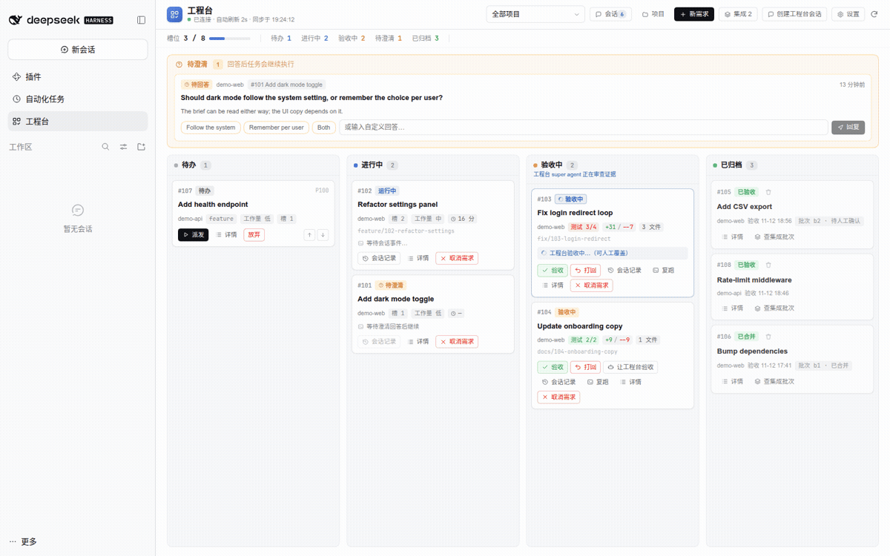
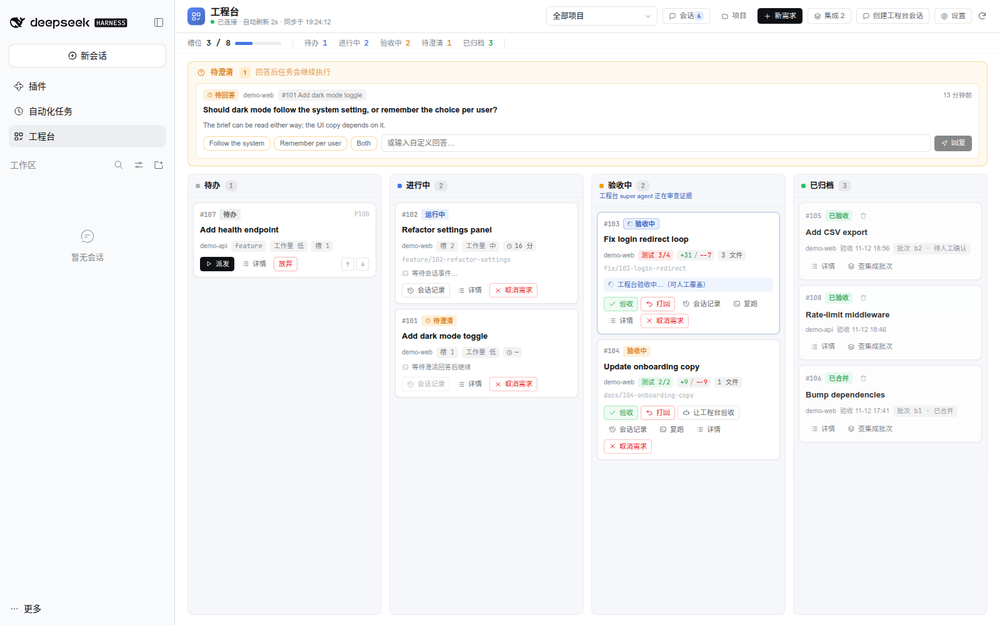
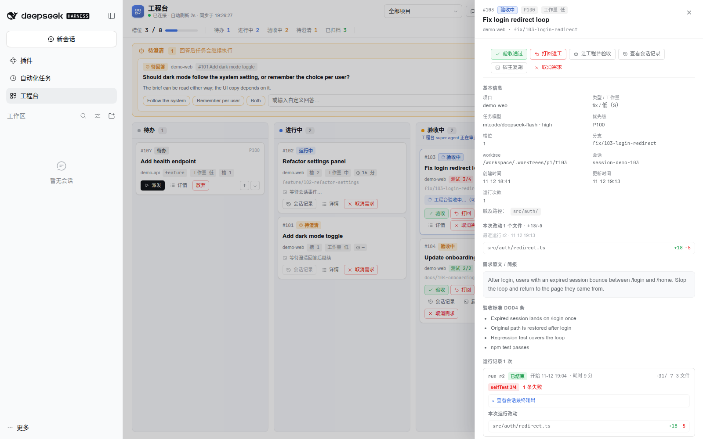
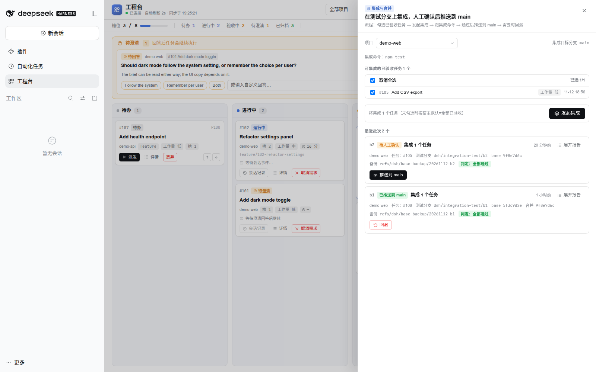

# Project Console for DeepSeek Harness

**A multi-task workbench for the [DeepSeek Harness](https://github.com/deepseek-ai/deepseek-harness) web UI.** Write a requirement, and the console gives it an isolated git worktree and an agent session that edits, tests, and collects evidence on its own. Accepted tasks go into an integration batch; the local base branch is only advanced after you confirm it.



[](https://www.npmjs.com/package/dsh-project-console)
[](https://github.com/revive123456/dsh-project-console/actions/workflows/ci.yml)
[](https://github.com/revive123456/dsh-project-console/blob/main/LICENSE)

[](https://github.com/revive123456/dsh-project-console/stargazers)

English | [中文](https://github.com/revive123456/dsh-project-console/blob/main/README.zh.md)

## What it is

Project Console is a persistent workbench inside DSH Web. You spend your time on three things: writing requirements, checking results, and confirming what reaches the base branch.

Each requirement becomes a task. The console creates a worktree outside the repository and starts an agent session there. When the task finishes, the console checks the diff, the commands it ran, and the project's verification commands. You can also inspect everything and accept or send it back yourself.

## Features

- **Parallel tasks** — each task has its own worktree and agent session, so changes do not overwrite each other.
- **Automatic review** — a finished task is checked against its acceptance criteria and the project's verification commands. A pass moves it to accepted; a failure is sent back or escalated.
- **Human control** — inspect the diff and evidence, accept, send back, add instructions, abandon, or resume a task.
- **Integration batches** — combine accepted tasks, run the project's integration commands on a test branch, then confirm before the local base branch is advanced.
- **Rollback** — after a push, revert the batch; tasks return to accepted and can be integrated again.
- **Clarification** — when a requirement is ambiguous, the console asks on the board. Answer it and the task continues.
- **Task sessions in one place** — task sessions live in the console's Sessions panel instead of the sidebar.
- **Acceptance reports** — accepted tasks can produce a single-file HTML report with inline screenshots. It opens offline and prints to PDF.
- **Reference screenshots** — attach screenshots when creating a task; the task session can read them.

## Screenshots

| Task board | Task detail and evidence |
| --- | --- |
|  |  |



## Install

**Requirements:** DeepSeek Harness **0.2.1 or newer** (web UI or desktop app), a Node.js **`^22.19 || >=24`** runtime, and **pnpm** for CLI installs (`npm i -g pnpm`, or `corepack enable`).

A plugin with a bundle layer is composed when the host starts, so **restart DSH after installing** (desktop: quit and reopen). Refreshing the page is not enough.

### Desktop app

1. Open **Settings → Plugins**.
2. Search for **`dsh-project-console`** and install it.
3. Restart DeepSeek Harness.

### CLI

```bash
dsh plugin --profile web add dsh-project-console
# restart the host
dsh web
```

Use the profile your host actually runs; `web` is the common CLI profile, while the desktop app manages its own.

### From source

```bash
git clone https://github.com/revive123456/dsh-project-console.git
cd dsh-project-console
npm test                         # builds host/client and runs the regression probes
dsh plugin --profile web add "$(pwd)"   # PowerShell: "$PWD"
# restart the host
```

The repository ships prebuilt `lib/` files, so installing from source does not need a separate build.

**Upgrade:** reinstall the package (or `git pull` and restart the host).

**Uninstall:** `dsh plugin --profile web remove dsh-project-console`, then restart.

## Usage

### Add a project

Open **Projects → Add** and fill in the repository path, base branch, worktree root, verification commands, and the other fields described under [Project configuration](#project-configuration).

### Create a task

Click **New requirement**, write the title and the requirement, and optionally attach screenshots. The work size (`xs`/`s`/`m`/`l`/`xl`) is chosen automatically; you can re-estimate it from the task detail.

### Task lifecycle

A task moves through: **todo → running → reviewing → accepted → merged**, plus **needs input**, **failed**, and **abandoned**.

- If the requirement is ambiguous, the console puts a question on the board; answering it resumes the task.
- If verification fails, the task is sent back automatically. You can also send it back or resume it yourself.
- Accepted but not yet merged work lives on the task branch; put it into an integration batch to keep it.

### Review

When a task finishes, the console reviews the diff, the commands it ran, and the evidence. Before accepting, it reruns the project's verification commands in the worktree; a failure sends the task back.

You can also inspect the diff and evidence and accept the task yourself. An accepted task can produce an acceptance report: a single-file HTML document with inline screenshots, readable offline and printable to PDF.

### Integrate and push

Select accepted tasks and click **Integrate**. The console creates a test branch, merges the tasks one by one, and runs the project's integration commands.

When the batch is green, confirm **Push to main**. This is a local fast-forward, not a push to a remote. If something is wrong, roll the batch back; the tasks return to accepted and can be integrated again.

### Settings

- **Workbench model** — the model used by the console's own session and by work-size estimation.
- **Workload models** — the model used for low / medium / high tasks.
- **Scheduling** — automatic dispatch and the global and per-project concurrency slots.
- **Review** — review mode, reviewer model, and how many screenshots may be inlined.

## Project configuration

```jsonc
{
  "name": "my-project",
  "repoPath": "/abs/path/to/repo",
  "baseBranch": "main",
  "worktreeRoot": "/abs/worktree/root",
  "slotBudget": 8,                       // concurrent tasks for this project
  "workerFilePolicy": "workspace-write", // write only inside the worktree; danger-full-access is trust mode
  "workerModel": {"provider": "mtcode", "model": "deepseek-flash", "reasoningEffort": "max"},
  "setup": {"copy": [], "commands": ["cp -a /repo/node_modules ./node_modules"]},
  "verify": {"commands": ["npm run typecheck", "npx vitest run --silent"]},
  "integrationTests": {"commands": ["npm run typecheck", "npx vitest run --silent"]}
}
```

`repoPath`, `baseBranch`, and `worktreeRoot` are required. `verify.commands` are rerun before accepting a task and are recommended; `integrationTests.commands` run inside an integration batch and are skipped when empty. `setup.commands` run in the worktree before dispatch, usually to copy dependencies. `workerModel` is the fallback when no model is configured for a work-size tier.

## Security boundaries

- Project Console runs git and shell commands on your machine with your user permissions. Use it only with repositories and requirements you trust.
- `workspace-write` limits what task sessions can write, not what they can read. Do not put credentials where an agent can read them. `danger-full-access` is a full trust mode.
- The console API is served by DSH Web, which listens on localhost by default. Write requests have a same-origin fence, but that is not authentication. Do not expose the DSH Web port to the public internet.
- Deleting a project or task, rolling back a batch, and pushing to the base branch are destructive. Deleting a project also removes task branches and worktrees; accepted-but-unmerged work is lost, so integrate it first or make sure you no longer need it.
- Task time, context, and token usage are managed by DSH. Long tasks and large repositories are slower and more expensive.

## Development

```bash
npm test          # build host/client, then run the regression probes
npm run build     # build the client only
npm run build:host
```

The probes under `probe/` cover rollback, acceptance gates, state transitions, path guards, and HTTP body handling.

## Architecture

```
src/index.js      host entry
src/core.js       state, paths, shell
src/git.js        worktrees, branches, integration batches, base-branch push
src/service.js    projects, tasks, dispatch, evidence, review, scheduling
src/report.js     acceptance report (single-file HTML)
src/http.js       /project-console-api routes
src/tools.js      project_* model tools
src/mount.js      assembly
src/client/       the web UI
lib/engine.mjs    built host bundle
lib/client.js     built client bundle
build-host.mjs    host build script
build.mjs         client build script
probe/            regression probes
```

## License

[MIT](https://github.com/revive123456/dsh-project-console/blob/main/LICENSE)
