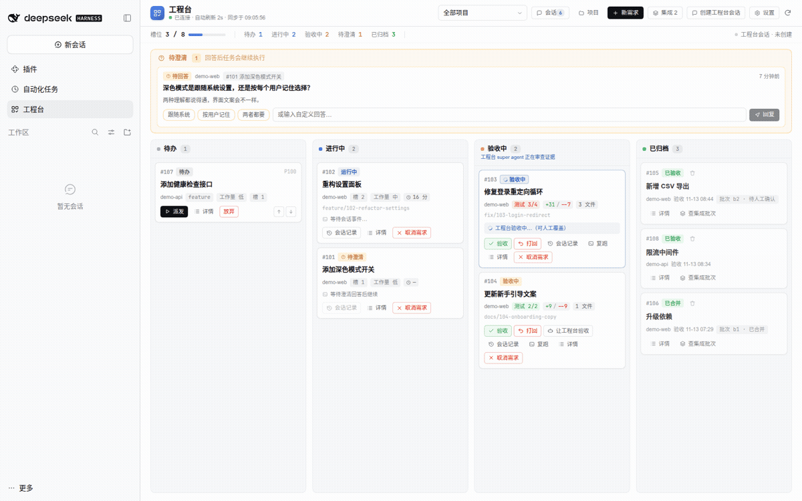
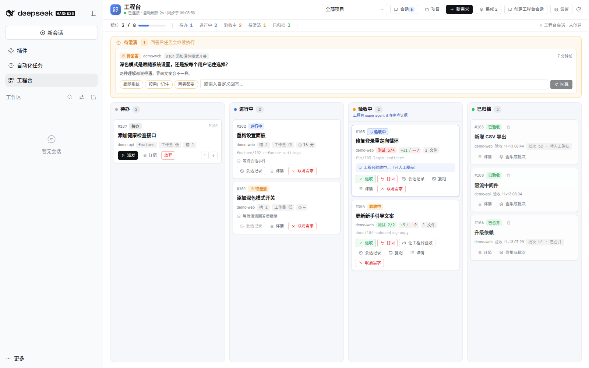
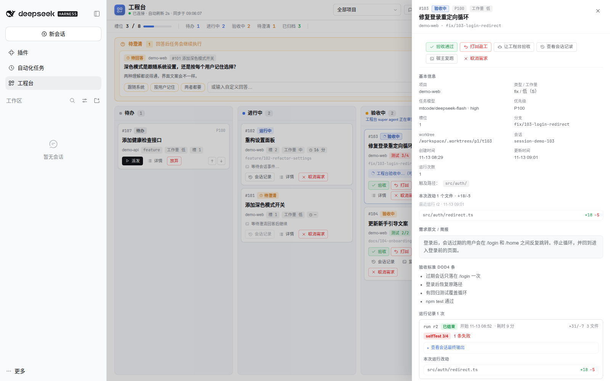
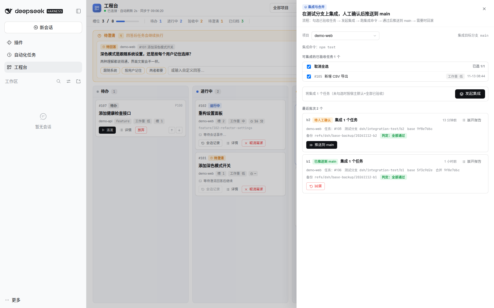

# 工程台 Project Console for DeepSeek Harness

**DSH Web 的多需求工作台。** 写一条需求，工程台给它一个独立的 git worktree 和一个 agent 会话，自己改、自己跑测试、自己交证据；验收通过进集成，人工确认后才推进本地主干分支。



[](https://www.npmjs.com/package/dsh-project-console)
[](https://github.com/revive123456/dsh-project-console/actions/workflows/ci.yml)
[](https://github.com/revive123456/dsh-project-console/blob/main/LICENSE)

[](https://github.com/revive123456/dsh-project-console/stargazers)

[English](https://github.com/revive123456/dsh-project-console/blob/main/README.md) | 中文

## 它是什么

工程台是 DSH Web 里的常驻工作台。你要做的主要是三件事：写需求、看结果、确认推送。

每条需求变成一个任务。工程台在仓库外建独立 worktree，起 agent 会话在里面干活；任务结束后检查 diff、跑过的命令和项目验证命令，通过后进已验收。你也可以自己看证据，决定通过还是打回。

## 功能

- **并行任务**：每条任务有自己的 worktree 和 agent 会话，改动互不覆盖。
- **自动验收**：任务完成后按验收标准、diff 和项目验证命令检查；通过进已验收，不通过自动返工或转人工。
- **人工把关**：看 diff 和证据，验收、打回、补指令、放弃或继续。
- **集成批次**：把已验收任务攒成一批，在测试分支上跑集成命令；通过后人工确认，才推进本地主干分支。
- **回滚**：推送后可回滚；任务回到已验收，可以重新集成。
- **待澄清**：需求有歧义时，工程台把问题放到看板；回答后任务继续。
- **会话集中**：任务会话收在工程台的「会话」面板里，不占左侧栏。
- **验收报告**：已验收任务可生成单文件 HTML，截图内联，离线可看，也能打印成 PDF。
- **中英界面**：跟随 DSH 的语言设置切换中文 / English。
- **参考截图**：提需求时可以贴截图，任务会话能直接查看。

## 截图

| 任务看板 | 任务详情与证据 |
| --- | --- |
|  |  |



## 安装

**前置要求：** DeepSeek Harness **0.2.1 或更新版本**（Web UI 或桌面版）、Node.js **`^22.19 || >=24`**；CLI 安装还需要 **pnpm**（`npm i -g pnpm` 或 `corepack enable`）。

带 bundle 层的插件在宿主启动时才会被组合进去，所以**装完要重启 DSH**（桌面版：退出后重新打开），刷新页面不够。

### 桌面版

1. 打开 **设置 → 插件**。
2. 搜索 **`dsh-project-console`** 并安装。
3. 重启 DeepSeek Harness。

### CLI

```bash
dsh plugin --profile web add dsh-project-console
# 重启宿主
dsh web
```

`web` 是常见的 CLI profile；桌面版使用它自己的 profile，优先用应用内安装。

### 从源码安装

```bash
git clone https://github.com/revive123456/dsh-project-console.git
cd dsh-project-console
npm test                         # 构建 host/client 并跑回归探针
dsh plugin --profile web add "$(pwd)"   # PowerShell: "$PWD"
# 重启宿主
```

仓库已带预构建的 `lib/`，从源码安装不需要额外构建。

**升级：** 重新安装包（或 `git pull` 后重启宿主）。

**卸载：** `dsh plugin --profile web remove dsh-project-console`，然后重启。

## 使用

### 添加项目

点 **项目 → 添加**，填仓库路径、主干分支、worktree 根目录、验证命令等。字段说明见下面「项目配置」。

### 提需求

点 **新建需求**，写标题和需求原文，可以贴参考截图。工作量（`xs`/`s`/`m`/`l`/`xl`）会自动判定；判断不合适可以在任务详情里重估。

### 任务状态

任务依次经过：**待办 → 运行中 → 验收中 → 已验收 → 已合并**，另外还有**待澄清、失败、已放弃**。

- 需求有歧义时，工程台把问题放到看板；回答后任务继续。
- 验证失败会自动返工；也可以手动打回或继续。
- 已验收但还没合并的改动在任务分支上；要保留就放进集成批次。

### 验收

任务跑完进入验收。工程台会看 diff、跑过的命令和证据，通过前还会在 worktree 里复跑项目验证命令；失败会打回。

也可以自己看 diff 和证据人工验收。已验收任务能生成验收报告：单文件 HTML，截图内联，离线可看，浏览器打印就是 PDF。

### 集成与推送

勾选已验收任务，点 **集成**：工程台建测试分支，逐任务合并，跑集成命令。

批次全绿后确认 **推送到 main**。这是本地 fast-forward，不推远端仓库。出问题可以回滚；回滚后任务回到已验收，可以重新集成。

### 设置

- **工作台模型**：工程台会话和工作量判定用哪个模型。
- **工作量模型**：低 / 中 / 高各自用哪个模型。
- **调度**：自动派发、全局和项目并发槽位。
- **验收**：验收方式、判定器模型、最多内联几张截图。

## 项目配置

```jsonc
{
  "name": "my-project",
  "repoPath": "/abs/path/to/repo",
  "baseBranch": "main",
  "worktreeRoot": "/abs/worktree/root",
  "slotBudget": 8,                       // 项目并发任务数
  "workerFilePolicy": "workspace-write", // 只允许写 worktree；danger-full-access 是信任模式
  "workerModel": {"provider": "mtcode", "model": "deepseek-flash", "reasoningEffort": "max"},
  "setup": {"copy": [], "commands": ["cp -a /repo/node_modules ./node_modules"]},
  "verify": {"commands": ["npm run typecheck", "npx vitest run --silent"]},
  "integrationTests": {"commands": ["npm run typecheck", "npx vitest run --silent"]}
}
```

`repoPath`、`baseBranch`、`worktreeRoot` 必填。`verify.commands` 是验收前复跑的命令，建议配上；`integrationTests.commands` 在集成批次里跑，留空则跳过。`setup.commands` 在派发前于 worktree 里执行，通常用来拷依赖；`workerModel` 是档位模型没配时的兜底。

## 安全边界

- 工程台在本机以你的用户权限运行 git 和 shell 命令。只对可信仓库、可信需求使用。
- `workspace-write` 限制任务会话写 worktree，不限制读取。不要把凭据放在 agent 能读到的位置；`danger-full-access` 是完全信任模式。
- 工程台 API 由 DSH Web 提供，默认只监听本机；写请求有同源挡板，但不是身份认证。不要把 DSH Web 端口暴露到公网。
- 删除项目、删除任务、回滚、推送到主干都是强操作。删除项目会连带清掉任务分支和 worktree；已验收但未合并的改动也会丢，先集成或确认不再需要。
- 任务时间、上下文和 token 消耗由 DSH 管理；长任务和大仓库更慢、更贵。

## 开发与测试

```bash
npm test          # 构建 host/client，然后跑回归探针
npm run build     # 只构建 client
npm run build:host
```

回归探针在 `probe/`，覆盖回滚、验收门禁、状态机、路径守卫和 HTTP 请求体。

## 代码结构

```
src/index.js      host 入口
src/core.js       状态、路径、shell
src/git.js        worktree、分支、集成批次、推送到主干
src/service.js    项目、任务、派发、证据、验收、调度
src/report.js     验收报告（单文件 HTML）
src/http.js       /project-console-api 路由
src/tools.js      project_* 模型工具
src/mount.js      装配层
src/client/       前端看板
lib/engine.mjs    host 构建产物
lib/client.js     client 构建产物
build-host.mjs    host 构建脚本
build.mjs         client 构建脚本
probe/            回归探针
```

## License

[MIT](https://github.com/revive123456/dsh-project-console/blob/main/LICENSE)
